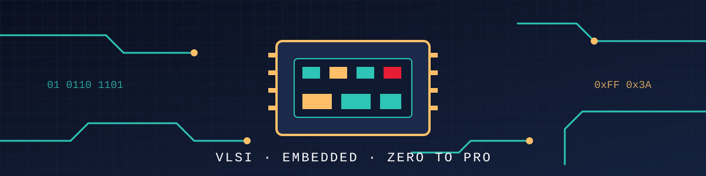

<p align="center">
  
</p>

# VLSI & Embedded: Zero to Pro

A free, open, curated roadmap that takes you from **absolute beginner** to **professional engineer** in VLSI (chip design) and Embedded Systems. Every stage lists the concepts to learn, the books, videos and courses to use, and the open-source tools to practise with.

You do not need prior knowledge. Start at Stage 0 and move forward. Skip what you already know, but do the checkpoint projects.

---

## How this repo is organised

| Path | What it covers |
|------|----------------|
| [`foundations/`](foundations/README.md) | Shared base: basic electronics, EMF, digital, analog, PCB design, MATLAB/Octave, Linux and Git |
| [`embedded/`](embedded/README.md) | Embedded systems: Assembly (x86, ARM, RISC-V), C/C++, protocols, hardware and firmware, STM32, RTOS |
| [`vlsi/`](vlsi/README.md) | VLSI: frontend, backend, analog, digital, verification, DFT, STA, protocols, mixed-signal, PDKs, open tools |

Learn **foundations first**, then pick **embedded**, **VLSI**, or both. Both tracks share the same base, so the foundations are not repeated.

---

## The Levels

Every track is split into four levels. Finish the checkpoint project before moving on.

| Level | Name | Goal | Checkpoint |
|-------|------|------|------------|
| 0 | Absolute beginner | Understand voltage, current, logic gates, and how to blink an LED | Build a breadboard circuit and explain it |
| 1 | Foundation | Write real code, read datasheets, understand digital design | Working project on a dev board or simulator |
| 2 | Intermediate | Design hardware and firmware, use buses and protocols | Design a small board or an RTL block that passes tests |
| 3 | Advanced / Pro | Real-world systems, verification, timing, tape-out or production-grade firmware | Portfolio project you can show in an interview |

---

## Quick start (first 30 days)

1. **Week 1:** Watch Ben Eater's "Build a breadboard computer" playlist. Install KiCad and Icarus Verilog.
2. **Week 2:** Complete the [foundations electronics checklist](foundations/README.md#level-0--absolute-beginner). Blink an LED with a microcontroller.
3. **Week 3:** Start C on an STM32 or Arduino. Learn GPIO, timers, and UART.
4. **Week 4:** Write your first Verilog module (an AND gate, then a counter) and simulate it.

---

## Contributing

Found a broken link, a better book, or a new open-source tool? Open a pull request. See [CONTRIBUTING.md](CONTRIBUTING.md).

Please only add resources that are free, open, or from reputable publishers, and keep links working.

## Disclaimer

Links and versions change. Check each resource's current status before relying on it. Book editions are listed where I'm confident of them; check the edition you buy.

## License

Content: CC BY 4.0. Code samples (if any): MIT.

---

## Quick git setup

```bash
git init
git add .
git commit -m "Initial commit: VLSI and Embedded zero to pro roadmap"
git branch -M main
git remote add origin https://github.com/<your-username>/vlsi-embedded-zero-to-pro.git
git push -u origin main
```
